<h1 align="center">North Star</h1>

  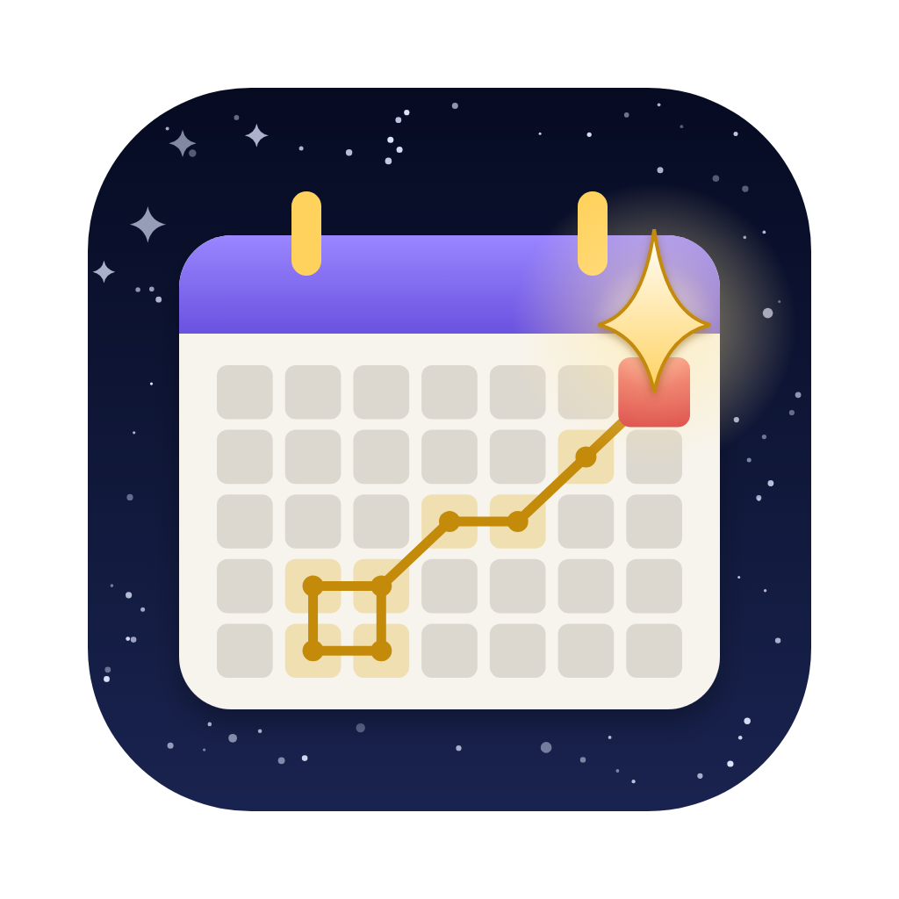

northstar is a rust-based, macOS, dekstop calendar app that centers around features maximizing your <b>north star</b>: long-term goals and productivity! the most popular calendar (gcal, notion) apps are

<ol>
  <li><b>lacking basic UI/UX features</b> that help when scheduling lots of events</li>
  <li>lack true features that <em>enable long-term planning</em> and reflection of goals.</li>
</ol>

  <a href="#a-uiux-upgrades">UI/UX Upgrades</a> · <a href="#b-productivity-add-ons">Productivity add-ons</a> · <a href="#implementation">Implementation</a>

  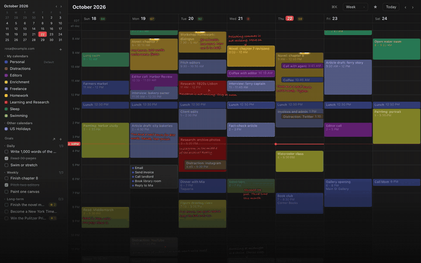

## A. UI/UX Upgrades

### 1. Overlapped Events

In google calendar its really hard to read overlapped events. Its a really simple fix of ensuring that overlapped events never add horizontal whitespace or random innents and clustering small-length events together in a more readable format.

  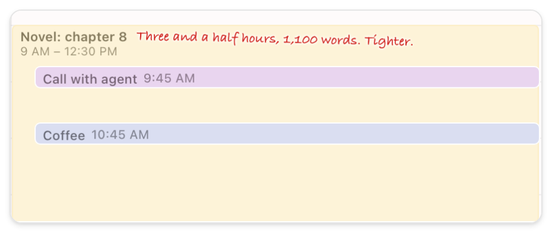
  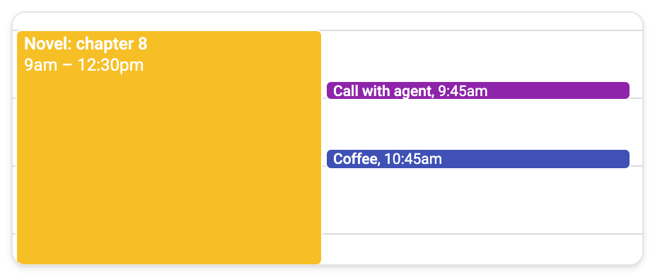
   
  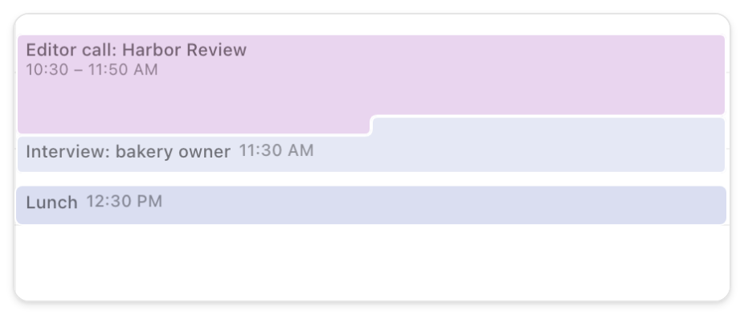
  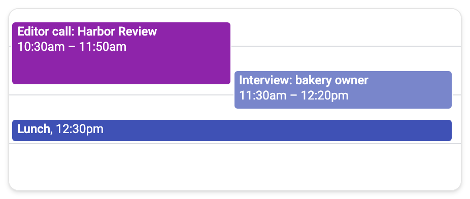
   
  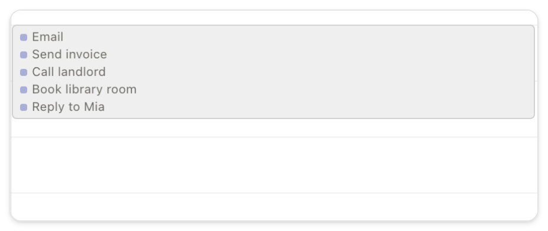
  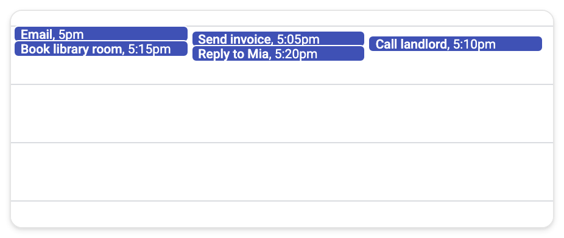

## B. Productivity add-ons

### 1. Reconcile Events

It's pretty common that you get lazy and forget to delete events that didn't happen -  by default, events are now dotted lines (didn't happen) and you have to manually "reconcile" events to mark events that happened or didn't.

  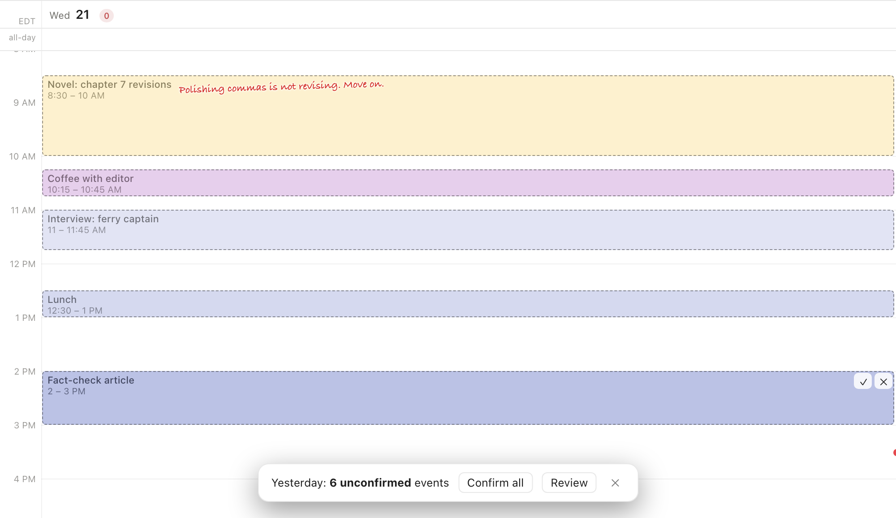
   Yesterday's events stay dotted until you confirm them: ✓ or ✕ on each, or Review them one at a time.

### 2. Annotations for reflection

Annotations are used in literature to critique writing, so why not apply this to your life? Let's imagine you printed your calendar this week and annotated your calendar do determine how well you accomplished your goals / what went wrong?

  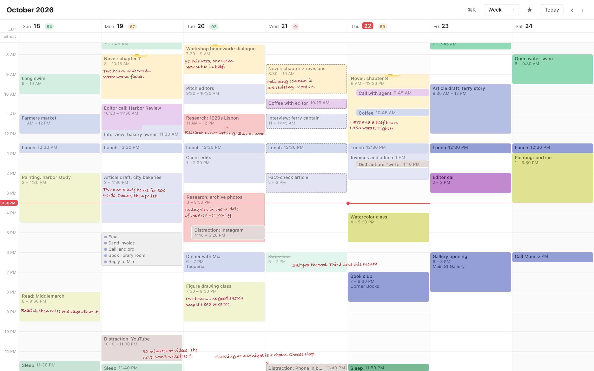
   Notes in the week's margins, each with an arrow to its event.

### 3. Focus score / Highlighted Events / Goal dashboard

Some cool small features that help [prime](https://en.wikipedia.org/wiki/Priming_%28psychology%29) oneself to be more self-critical and evaluative of their goals? are a focus score that ranks deep work and. highlighting goal-driven events with pretty ui animations, and goal dashboard.  

  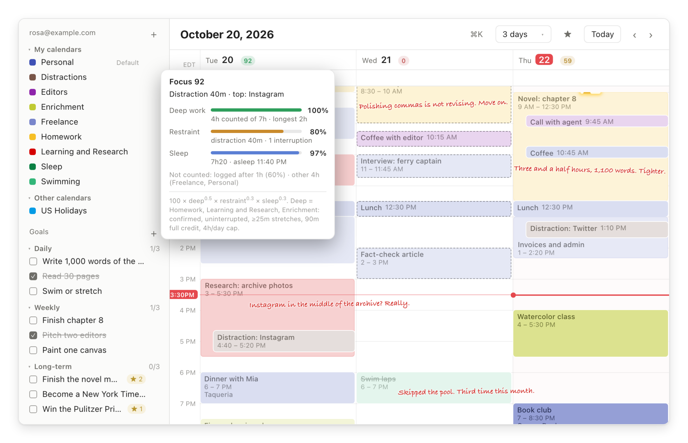
   Tuesday's focus score explained · Thursday's goal work highlighted · the goal dashboard in the sidebar.

## Implementation

northstar is a [Tauri 2](https://tauri.app/) app: a Rust core and a React + TypeScript interface in the system's WebKit view. It is local-first. Events live in a local SQLite database and sync both ways with Google Calendar; the goal classification comes from a local model (via [Ollama](https://ollama.com/)), so nothing else leaves the machine.

- **Sync core** ([`crates/sync-core`](crates/sync-core), Rust): the SQLite store and the Google Calendar client. Incremental sync with sync tokens (a 410 triggers a full resync), writes guarded by ETags (`If-Match`; on a 412 the remote copy wins), echo suppression for its own writes, and the OAuth refresh token kept in the macOS keychain.
- **App shell** ([`src-tauri`](src-tauri)): the commands the interface calls (events, calendars, goals), the sync thread, the menu bar item, and the goal classifier ([`classify.rs`](src-tauri/src/classify.rs)), which can ask a local model which events served a goal (switched off for now).
- **Interface** ([`src`](src)): the week/day, month, agenda and insights views. The layout work is pure TypeScript in [`src/lib`](src/lib):
  - [`layout.ts`](src/lib/layout.ts) packs overlapping events into C-shapes, rabbet joints and clusters, never leaving horizontal gaps;
  - [`labelPlace.ts`](src/lib/labelPlace.ts) places each event's title and time inside the part of its shape that stays visible;
  - [`marginNotes.ts`](src/lib/marginNotes.ts) places annotations in free space with arrows back to their events: a candidate search over a summed-area table of the page, then simulated annealing, in a Web Worker;
  - [`insights.ts`](src/lib/insights.ts) computes the focus score ([design notes](design/focus-score.md)), [`recon.ts`](src/lib/recon.ts) reconciliation, [`goals.ts`](src/lib/goals.ts) goals.
- **Tests** ([`e2e`](e2e)): Playwright drives the interface against an in-browser mock backend, and the real WebKit window through a debug-only test hook plus WebDriver. Layout rules (no covered text, no blank gaps inside overlaps, annotations whole and tied to their event) are checked on synthetic weeks and on real ones.

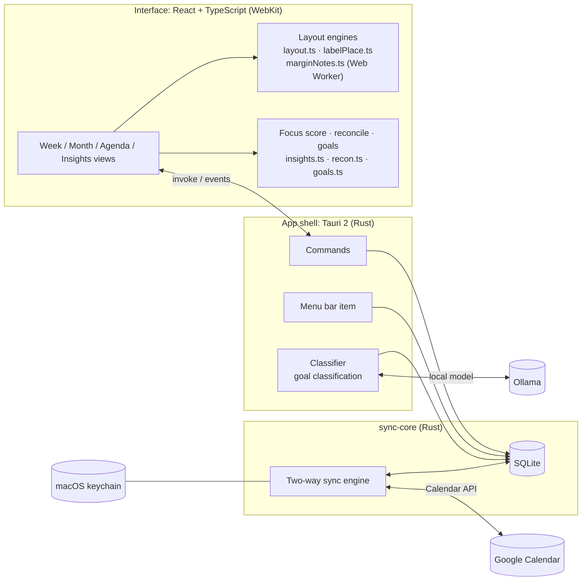
